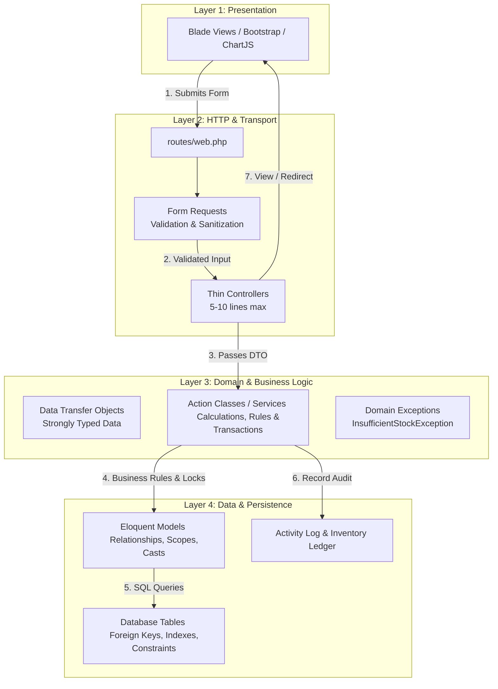

# Enterprise ERP System Architecture Guide (10+ Years Experience)

Welcome to the architectural blueprint for the **Apex ERP System**. This document outlines how a Senior Technical Architect / Staff Engineer designs and structures a production-grade enterprise ERP using Laravel.

---

## 1. Core Philosophy: Why Architecture Matters

In enterprise software (especially an ERP), the cost of bugs is measured in lost inventory, accounting errors, and compliance failures.

```
Junior Developer: "How quickly can I show something on the screen?"
Senior Architect: "How can I guarantee data integrity, zero race conditions, and effortless maintenance 5 years from now?"
```

### The 4 Non-Negotiable Rules of ERP Development:
1. **The Ledger Principle (Immutability):** Never overwrite historical data. Every stock movement or financial change is an immutable row in an audit ledger.
2. **Transactional Integrity:** Any operation that modifies more than one table must be wrapped in a database transaction (`DB::transaction()`).
3. **Concurrency Protection:** Protect critical stock and money operations against race conditions using pessimistic locking (`lockForUpdate()`).
4. **Exact Precision:** Never use floating-point numbers (`float` / `double`) for money or quantities. Always use `DECIMAL(15, 4)` or integer cents to prevent rounding drift.

---

## 2. The 4-Layer Architecture

Instead of dumping all code into one massive "God Controller" (like the prototype `AdminController.php`), the application is divided into **4 distinct layers**:



---

### Layer-by-Layer Breakdown

### Layer 1: Presentation Layer (`resources/views/`)
* **Role:** Render the user interface and submit forms.
* **Rules:**
  - **No SQL queries in views** (e.g., `App\Models\Product::count()` inside Blade is strictly forbidden).
  - Only use data passed directly from the Controller or ViewModel.
  - Keep Blade templates focused purely on layout, formatting, and UI state.

### Layer 2: HTTP / Traffic Layer (`app/Http/`)
* **Role:** Handle HTTP requests and send back HTTP responses.
* **Components:**
  1. **Routes (`routes/web.php`):** Clean routing definitions.
  2. **Form Requests (`app/Http/Requests/`):** Validate incoming inputs, check data types, and enforce input rules before the controller is ever touched.
  3. **Controllers (`app/Http/Controllers/`):** "Thin Controllers". Controllers **do not** calculate taxes, decrement inventory, or run complex business logic. Their only job is:
     1. Accept the validated Form Request.
     2. Call the appropriate Action class.
     3. Return a view, redirect, or JSON response.

### Layer 3: Domain & Business Logic Layer (`app/Actions/` & `app/Services/`)
* **Role:** The brain of the ERP. This code represents your business operations.
* **Why this is separate:** It is 100% decoupled from HTTP. You can run the exact same `CreateOrderAction` from a web form, a REST API, a console Artisan command, or an automated webhook without duplicating one line of code.
* **Key Patterns:**
  - **Single Action Classes:** One class = One business operation (e.g., `CreateOrderAction`, `AdjustStockAction`, `CancelOrderAction`).
  - **Database Transactions:** Every action wraps its steps in `DB::transaction()`.
  - **Pessimistic Locking:** `lockForUpdate()` ensures two users cannot buy the last item at the exact same millisecond.

### Layer 4: Data & Persistence Layer (`app/Models/` & `database/`)
* **Role:** Define database structure, relationships, and queries.
* **Key Practices:**
  - **Strict Typing & Attribute Casting:** Cast dates to `Carbon`, prices to decimals/integers, and JSON fields to arrays.
  - **Foreign Key Constraints:** Use `cascadeOnDelete()` or `restrictOnDelete()` deliberately. Never leave orphan records.
  - **Query Scopes:** Move reusable query logic into models (e.g., `Product::lowStock()`, `Order::forCurrentMonth()`).

---

## 3. Directory Structure Blueprint

Here is how the project directory will be organized:

```
app/
├── Actions/                       # Single-purpose business actions (The Brain)
│   ├── Inventory/
│   │   ├── AdjustStockAction.php
│   │   └── TransferStockAction.php
│   ├── Orders/
│   │   ├── CreateOrderAction.php
│   │   ├── CancelOrderAction.php
│   │   └── FulfillOrderAction.php
│   └── Invoices/
│       └── GenerateInvoiceAction.php
│
├── DTOs/                          # Data Transfer Objects (Strictly typed input)
│   ├── OrderItemData.php
│   └── CreateOrderData.php
│
├── Exceptions/                    # Custom Domain Exceptions
│   ├── InsufficientStockException.php
│   └── OrderAlreadyFulfilledException.php
│
├── Http/
│   ├── Controllers/
│   │   ├── Admin/
│   │   │   ├── DashboardController.php   # Replaces the monolithic AdminController
│   │   │   ├── InventoryController.php
│   │   │   ├── OrderController.php
│   │   │   ├── CustomerController.php
│   │   │   └── ActivityLogController.php
│   │   └── AuthController.php
│   └── Requests/                  # Form validation classes
│       ├── StoreProductRequest.php
│       ├── AdjustStockRequest.php
│       └── StoreOrderRequest.php
│
├── Models/                        # Database Entities & Relationships
│   ├── Category.php
│   ├── Product.php
│   ├── InventoryMovement.php     # Immutable Stock Ledger
│   ├── Customer.php
│   ├── Order.php
│   ├── OrderItem.php
│   ├── Invoice.php
│   └── User.php
│
└── Services/                      # Infrastructure services (PDF, Exports, Math)
    └── InvoicePdfService.php
```

---

## 4. Real-World Code Comparison

### Scenario: Creating an Order with Stock Deduction

#### The Junior Way (Anti-pattern: All inside Controller)
```php
// Bad: In AdminController.php
public function storeOrder(Request $request) {
    // 1. Loose validation
    $product = Product::find($request->product_id);

    // Race condition bug: Another customer could buy this right now!
    if ($product->stock < $request->quantity) {
        return back()->with('error', 'Out of stock');
    }

    // 2. Direct mutation (No history or ledger)
    $product->stock = $product->stock - $request->quantity;
    $product->save();

    // 3. Creating order with float math (rounding errors!)
    $total = (float)$request->price * (int)$request->quantity;
    $order = Order::create([
        'total' => $total,
        // ...
    ]);

    return redirect('/orders');
}
```

---

#### The 10-Year Architect Way (Modular, Safe, Auditable)

#### Step 1: Validate with Form Request (`StoreOrderRequest.php`)
```php
namespace App\Http\Requests;

use Illuminate\Foundation\Http\FormRequest;

class StoreOrderRequest extends FormRequest
{
    public function authorize(): bool
    {
        return true; // We will layer permissions here later
    }

    public function rules(): array
    {
        return [
            'customer_id' => ['required', 'exists:customers,id'],
            'items' => ['required', 'array', 'min:1'],
            'items.*.product_id' => ['required', 'exists:products,id'],
            'items.*.quantity' => ['required', 'integer', 'min:1'],
            'items.*.unit_price' => ['required', 'numeric', 'min:0'],
            'notes' => ['nullable', 'string', 'max:500'],
        ];
    }
}
```

#### Step 2: The Thin Controller (`OrderController.php`)
```php
namespace App\Http\Controllers\Admin;

use App\Http\Controllers\Controller;
use App\Http\Requests\StoreOrderRequest;
use App\Actions\Orders\CreateOrderAction;
use Illuminate\Http\RedirectResponse;

class OrderController extends Controller
{
    public function store(StoreOrderRequest $request, CreateOrderAction $createOrder): RedirectResponse
    {
        $order = $createOrder->execute(
            validatedData: $request->validated(),
            userId: auth()->id()
        );

        return redirect()
            ->route('admin.orders.show', $order)
            ->with('success', "Order #{$order->order_number} successfully placed.");
    }
}
```

#### Step 3: The Action Class with Concurrency Control (`CreateOrderAction.php`)
```php
namespace App\Actions\Orders;

use App\Models\Order;
use App\Models\Product;
use App\Models\InventoryMovement;
use App\Exceptions\InsufficientStockException;
use Illuminate\Support\Facades\DB;
use Illuminate\Support\Str;

class CreateOrderAction
{
    public function execute(array $validatedData, int $userId): Order
    {
        return DB::transaction(function () use ($validatedData, $userId) {
            $subtotal = 0;
            $itemsToCreate = [];

            foreach ($validatedData['items'] as $itemData) {
                // PESSIMISTIC LOCKING: Lock row so concurrent requests wait
                $product = Product::where('id', $itemData['product_id'])
                    ->lockForUpdate()
                    ->firstOrFail();

                if ($product->stock_quantity < $itemData['quantity']) {
                    throw new InsufficientStockException("Insufficient stock for SKU: {$product->sku}");
                }

                // Calculate item total using exact decimal math
                $lineTotal = bcmul((string)$itemData['unit_price'], (string)$itemData['quantity'], 2);
                $subtotal = bcadd((string)$subtotal, (string)$lineTotal, 2);

                // Atomic stock decrement
                $product->decrement('stock_quantity', $itemData['quantity']);

                // Record in Immutable Stock Ledger
                InventoryMovement::create([
                    'product_id' => $product->id,
                    'user_id' => $userId,
                    'movement_type' => 'OUT',
                    'quantity' => -$itemData['quantity'],
                    'balance_after' => $product->fresh()->stock_quantity,
                    'reason' => 'Customer Order Fulfillment',
                ]);

                $itemsToCreate[] = [
                    'product_id' => $product->id,
                    'quantity' => $itemData['quantity'],
                    'unit_price' => $itemData['unit_price'],
                    'line_total' => $lineTotal,
                ];
            }

            // Create Order Master Record
            $order = Order::create([
                'order_number' => 'ORD-' . strtoupper(Str::random(8)),
                'customer_id' => $validatedData['customer_id'],
                'user_id' => $userId,
                'status' => 'Processing',
                'subtotal' => $subtotal,
                'tax_amount' => bcmul((string)$subtotal, '0.08', 2), // 8% Tax
                'total_amount' => bcadd((string)$subtotal, bcmul((string)$subtotal, '0.08', 2), 2),
                'notes' => $validatedData['notes'] ?? null,
            ]);

            // Create Order Items
            $order->items()->createMany($itemsToCreate);

            return $order;
        });
    }
}
```

---

## 5. How Permissions Will Plug In Later (Zero Rewrites)

Because the architecture separates the HTTP layer from the Business Logic, adding authorization later requires **zero changes** to your business logic or database queries.

When you are ready to enable permissions:
1. Generate a Policy:
   ```bash
   php artisan make:policy OrderPolicy --model=Order
   ```
2. Define the rule in the Policy:
   ```php
   public function create(User $user): bool
   {
       return $user->hasPermissionTo('manage-orders');
   }
   ```
3. Authorize in the Controller or Form Request:
   ```php
   // In OrderController.php
   $this->authorize('create', Order::class);
   ```
Your business logic in `CreateOrderAction` remains untouched.

---

## 6. Step-by-Step Implementation Roadmap

You will code the system following this structured order:

- [ ] **Phase 1: Catalog & Products (The Foundation)**
  - Migrations: `categories`, `products`.
  - Eloquent Models with relationships and scopes.
  - Category & Product CRUD with `StoreProductRequest`.

- [ ] **Phase 2: Inventory & The Movement Ledger**
  - Migrations: `inventory_movements`.
  - `AdjustStockAction` with `lockForUpdate()`.
  - Connect dynamic data to [`inventory/index.blade.php`](file:///e:/ERP-system/resources/views/admin/inventory/index.blade.php).

- [ ] **Phase 3: Customers & Orders**
  - Migrations: `customers`, `orders`, `order_items`.
  - `CreateOrderAction` with DB transaction and atomic stock deductions.
  - Connect dynamic data to [`orders/index.blade.php`](file:///e:/ERP-system/resources/views/admin/orders/index.blade.php).

- [ ] **Phase 4: Billing & PDF Generation**
  - Generate sequential invoices (`INV-2026-0001`).
  - Stream/download PDF using DomPDF.

- [ ] **Phase 5: Security & Permissions**
  - Attach Spatie roles & permissions to route middleware and Laravel policies.
